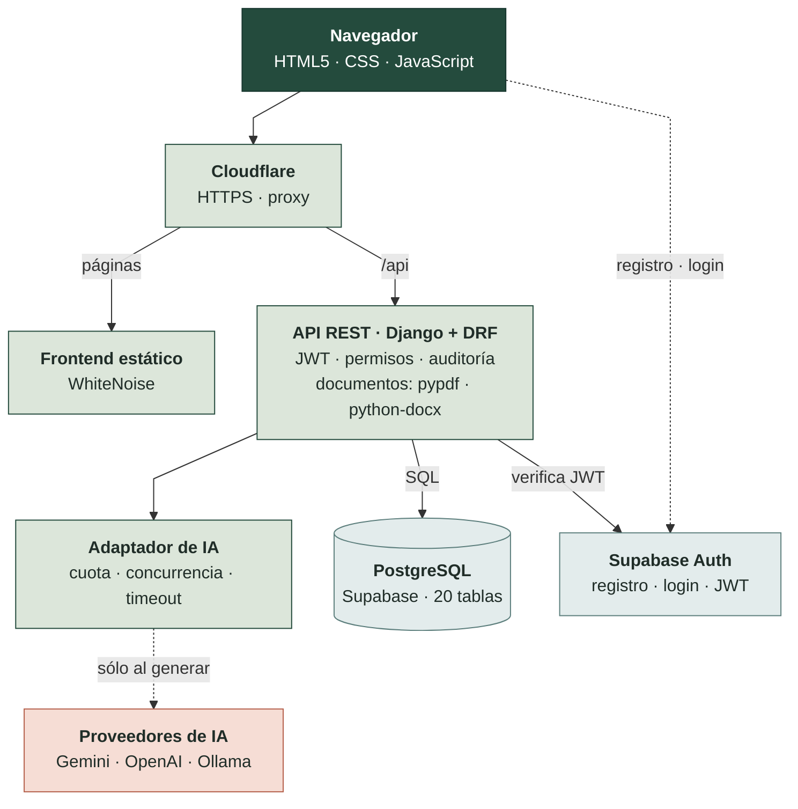
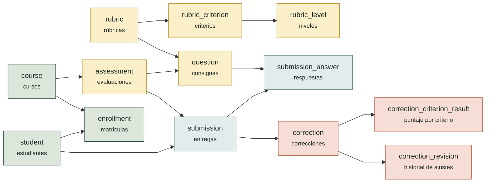

<div align="center">


### Corregir menos. Enseñar más.

**Asistente inteligente para la corrección docente:** organiza cursos, evaluaciones y rúbricas, y usa inteligencia artificial para proponer correcciones con evidencia citada y devoluciones pedagógicas que el docente revisa y aprueba.

[](docs/CHANGELOG.md)
[](https://www.python.org/)
[](https://www.djangoproject.com/)
[](https://www.django-rest-framework.org/)
[](https://supabase.com/)
[](frontend/)
[](https://maestria-amcn.onrender.com/)

**[🌐 Ver el sitio en producción](https://maestria-amcn.onrender.com/)** · [Arquitectura](#-arquitectura) · [Ejecutar localmente](#-ejecución-local) · [API](docs/API.md) · [Historial de cambios](docs/CHANGELOG.md)

</div>

---

## 📑 Contenido

- [El problema](#-el-problema)
- [La solución](#-la-solución)
- [Funcionalidades](#-funcionalidades)
- [Niveles de usuario](#-niveles-de-usuario)
- [Tecnologías](#-tecnologías)
- [Arquitectura](#-arquitectura)
- [Base de datos](#-base-de-datos)
- [Seguridad y privacidad](#-seguridad-y-privacidad)
- [Estructura del repositorio](#-estructura-del-repositorio)
- [Ejecución local](#-ejecución-local)
- [Pruebas y calidad](#-pruebas-y-calidad)
- [Despliegue](#-despliegue)
- [Límites conocidos](#-límites-conocidos)
- [Documentación](#-documentación)
- [Equipo](#-equipo)

---

## 🎯 El problema

Corregir consume una enorme cantidad de horas docentes. Un profesor con varios cursos puede acumular cientos de entregas por cuatrimestre y, además de poner una nota, tiene que escribir una devolución que le sirva al estudiante. El resultado es conocido:

- **Correcciones tardías**, que llegan cuando el estudiante ya pasó al tema siguiente.
- **Criterios desparejos** entre la primera y la última entrega corregida.
- **Devoluciones pobres**: la retroalimentación es lo primero que se recorta cuando falta tiempo.

## 💡 La solución

MaestrIA es una plataforma web que acompaña al docente en todo el ciclo de evaluación: preparar la evaluación y su rúbrica, recibir las entregas, obtener una **propuesta de corrección generada por IA** y revisarla antes de aprobarla.

> **La IA propone. El docente decide.**
> Ninguna propuesta se convierte en calificación sin revisión y aprobación humana. Cada criterio cita textualmente la parte de la respuesta en la que se basa; si la IA inventa una cita, la propuesta se descarta. Cada ajuste del docente queda registrado con su motivo.

<table>
<tr>
<td width="33%" valign="top">

**1 · Contexto**
Curso, evaluación, objetivos, consignas con respuesta esperada, material de referencia y rúbrica ponderada.

</td>
<td width="33%" valign="top">

**2 · Entrega**
Respuesta del estudiante en texto o archivo (PDF, DOCX, TXT). La IA genera una propuesta por criterio.

</td>
<td width="33%" valign="top">

**3 · Revisión**
Puntajes con evidencia resaltada, ajustes con motivo, aprobación con trazabilidad y devolución lista para compartir.

</td>
</tr>
</table>

---

## ✨ Funcionalidades

### Sitio público

| Página | Contenido |
|---|---|
| **Inicio** (`/`) | Propuesta de valor, problemas que resuelve, beneficios, principio de revisión humana y preguntas frecuentes. |
| **Cómo funciona** | Recorrido en tres etapas y demostración visual de una evaluación. |
| **Nosotros** | Origen del proyecto, equipo y **formulario de contacto** (se guarda en `contact_message`). |
| **Acceso** | Ingreso, registro con confirmación de correo y recuperación/restablecimiento de contraseña (Supabase Auth). |
| **Accesibilidad · Privacidad · Términos** | Páginas informativas del MVP. |

Diseño responsive, HTML semántico, navegación por teclado, foco visible y desplegables accesibles.

### Espacio docente

| Módulo | Operaciones |
|---|---|
| **Panel docente** | Indicadores (por revisar, revisadas, tiempo ahorrado) que abren el historial filtrado; guía de uso; tema claro/oscuro. |
| **Mis materias** | Alta, edición, archivado/reactivación y detalle por curso (estudiantes, evaluaciones, entregas y correcciones). |
| **Estudiantes** | Alta, edición, activación/desactivación, **importación CSV** con plantilla y matrículas por curso. |
| **Evaluaciones** | Alta y edición, objetivos, instrucciones, material de referencia importado desde PDF/DOCX/TXT y estados. |
| **Consignas** | Alta, edición, duplicado, reordenamiento y baja; **sugerencias generadas por IA**. |
| **Rúbricas** | Criterios con peso y puntaje máximo, niveles de desempeño, normalización de pesos al 100 % y **generación asistida por IA**. |
| **Espacio de trabajo** | Flujo Contexto → Entrega → Revisión, cola de entregas filtrable y edición de entregas. |
| **Correcciones** | Propuesta IA por criterio con evidencia citada, ajuste de puntajes con motivo, aprobación, historial de revisiones. |
| **Devoluciones** | Copiar, exportar (Markdown), imprimir/PDF, enviar por correo o WhatsApp, con registro de envíos. |
| **Mi perfil** | Datos de la cuenta, actividad reciente y cierre de sesión. |

### Administración

| Sección | Operaciones |
|---|---|
| **Usuarios** | Perfiles vinculados a identidades de Supabase: edición, roles y suspensión/reactivación. |
| **Instituciones** | Alta y edición de instituciones y gestión de **membresías** (docente, administrador de departamento, administrador institucional). |
| **Contacto** | Bandeja de mensajes del sitio público con estados (nuevo, en gestión, atendido, spam) y notas internas. |
| **Servicios e IA** | Configuración de proveedores (mock, Gemini, OpenAI, Ollama), modelo, prioridad, tiempos y costos. |
| **Auditoría** | Registro de eventos con búsqueda: quién hizo qué, sobre qué objeto y cuándo. |

---

## 👥 Niveles de usuario

| Acción | Visitante | Docente | Administrador | Superadministrador |
|---|:---:|:---:|:---:|:---:|
| Navegar el sitio público y enviar contacto | ✅ | ✅ | ✅ | ✅ |
| Registrarse y recuperar contraseña | ✅ | — | — | — |
| Espacio docente (sólo sus propios datos) | ❌ | ✅ | ❌ | ❌ |
| Correcciones con IA y aprobación | ❌ | ✅ | ❌ | ❌ |
| Panel de administración | ❌ | ❌ | ✅ | ✅ |
| Gestionar usuarios docentes, instituciones, contacto y auditoría | ❌ | ❌ | ✅ | ✅ |
| Asignar roles administrativos | ❌ | ❌ | ❌ | ✅ |
| Habilitar un proveedor de IA externo | ❌ | ❌ | ❌ | ✅ |

- Toda cuenta nueva es **docente**: un trigger de la base crea su perfil al registrarse. Los roles administrativos sólo los asigna un superadministrador, y la base impide degradar o suspender al último superadministrador activo.
- Sin sesión, el espacio docente redirige a la página de acceso y la API responde `401`. Un docente que intenta usar la API administrativa recibe `403`.
- El esquema contempla además el rol `student` y los roles institucionales; no tienen interfaz propia en esta versión (ver [Límites conocidos](#-límites-conocidos)).

---

## 🛠 Tecnologías

| Capa | Tecnología | Uso |
|---|---|---|
| **Frontend** | HTML5, CSS3, JavaScript (módulos ES) | Sitio público y SPA del espacio docente con vistas enlazables (`?view=…`). Sin frameworks, sin `npm install` ni build. |
| **Backend** | Python 3.12, Django 5, Django REST Framework | API REST, reglas de negocio, permisos, integración con IA y servicio del frontend. |
| **Base de datos** | PostgreSQL en Supabase (psycopg 3) | Esquema `public` con integridad referencial, triggers, restricciones y RLS. |
| **Autenticación** | Supabase Auth + JWT (PyJWT, JWKS) | Registro, confirmación de correo, sesión y recuperación de contraseña. |
| **Inteligencia artificial** | Adaptador propio: Gemini, OpenAI, Ollama, mock | Propuestas de corrección, consignas y rúbricas, con cuota, concurrencia y tiempo máximo controlados. |
| **Documentos** | pypdf, python-docx | Extracción de texto de entregas y materiales (en memoria; no se guardan los archivos). |
| **Infraestructura** | Render, Gunicorn, WhiteNoise, Cloudflare | Un único servicio web sirve frontend y API desde el mismo dominio. |
| **Calidad** | pytest, GitHub Actions, scripts de verificación | Pruebas de backend, chequeos estáticos del frontend y contrato de CSP. |

---

## 🏗 Arquitectura



<sub>Verde claro: servicio web en Render · celeste: Supabase · rosa: servicios externos bajo demanda. Versión detallada: [`docs/architecture-maestria.png`](docs/architecture-maestria.png).</sub>

- **Un solo origen:** Django sirve las páginas de `frontend/html/` y publica CSS, JS e imágenes bajo `/assets/` con WhiteNoise. En producción el frontend detecta el mismo origen y usa `/api`.
- **Sesión:** el navegador obtiene el JWT de Supabase Auth; cada petición a la API lo envía y Django verifica su firma con las claves públicas (JWKS) antes de comprobar el perfil y el rol.
- **IA del lado del servidor:** las claves de los proveedores viven sólo en el backend. `GET /api/client-config/` entrega únicamente la URL de Supabase y la clave pública anon.
- **El esquema es la fuente de verdad:** los modelos de Django usan `db_table` y `managed = False`; los cambios de base se hacen con migraciones SQL versionadas.

Más detalle en [`docs/BACKEND-ARCHITECTURE.md`](docs/BACKEND-ARCHITECTURE.md) y [`docs/FRONTEND-ARCHITECTURE.md`](docs/FRONTEND-ARCHITECTURE.md).

---

## 🗄 Base de datos

Veinte tablas en el esquema `public` de PostgreSQL (Supabase):



<sub>Cada flecha es una relación uno a muchos (1 → N). Las tablas de usuarios, instituciones y plataforma se listan abajo.</sub>

| Grupo | Tablas |
|---|---|
| Cursos y estudiantes | `course`, `student`, `enrollment` |
| Evaluaciones | `assessment`, `question` |
| Rúbricas | `rubric`, `rubric_criterion`, `rubric_level` |
| Entregas | `submission`, `submission_answer` |
| Correcciones | `correction`, `correction_criterion_result`, `correction_revision`, `ai_generation` |
| Usuarios e instituciones | `user_profile`, `institution`, `institution_membership` |
| Plataforma | `contact_message`, `audit_event`, `ai_provider_config`, `django_cache` |

**Integridad en la propia base:**

- Claves foráneas compuestas con `owner_id`: un docente no puede vincular datos de otro, ni siquiera por error del código.
- Triggers de validación (puntajes de niveles y criterios, consignas de una misma evaluación), `updated_at` automático y alta del perfil al registrarse (`maestria_sync_auth_user_profile`).
- Protección del último superadministrador (`maestria_guard_last_superadmin`).
- Seguridad a nivel de fila (RLS) y un rol de aplicación con privilegios mínimos.

**Instalación limpia** (proyecto Supabase nuevo o Supabase local): ejecutar `db/maestria_schema.sql` —snapshot del esquema de producción— y luego, en orden, las migraciones de `backend/database/migrations/` posteriores a la versión indicada en su encabezado. Los scripts `db/maestria_schema_v2*.sql` son históricos (ver [`docs/auditoria/AUDITORIA-SUPABASE-2026-11-09.md`](docs/auditoria/AUDITORIA-SUPABASE-2026-11-09.md)).

> ⚠️ **No ejecutar** `migrate`, `makemigrations` ni `--fake` para crear tablas de negocio: el dominio `core` no se gestiona con migraciones de Django.

Verificación de sólo lectura del esquema contra lo que espera el backend:

```powershell
cd backend
.\.venv\Scripts\python.exe manage.py verify_public_schema
```

---

## 🔒 Seguridad y privacidad

| Medida | Detalle |
|---|---|
| Autenticación | JWT de Supabase verificado en el servidor con JWKS; un perfil faltante o inactivo nunca obtiene acceso. |
| Autorización | Permisos por rol en cada endpoint y filtrado por propietario en cada consulta. |
| Mínimo privilegio | Los administradores no ven datos pedagógicos; sólo el superadministrador asigna roles o habilita IA externa. |
| Límites de uso | 60 peticiones/min anónimas, 900/min por usuario y 120/hora para IA; cuota diaria de IA por docente y tope de generaciones simultáneas. |
| Contacto | Validación en cliente y servidor, campo trampa antispam; el backend fija estado y origen del mensaje. |
| IA responsable | Evidencia citada validada literalmente; aprobación humana obligatoria; bloqueo *fail-closed* de proveedores externos sin autorización. |
| Archivos | Se procesan en memoria y sólo se guarda el texto extraído. |
| Navegador | Contrato de Content Security Policy verificado en CI, sesión por pestaña y `Clear-Site-Data` entre versiones. |
| Auditoría | Eventos de negocio y administración en `audit_event`, con retención configurada. |

Antes de procesar datos reales con un proveedor externo, revisar [`docs/CONFIGURACION-IA-EXTERNA.md`](docs/CONFIGURACION-IA-EXTERNA.md) y [`docs/SECURITY-AND-PRIVACY.md`](docs/SECURITY-AND-PRIVACY.md).

---

## 📁 Estructura del repositorio

```text
maestria-starter/
├── frontend/
│   ├── html/                 # Páginas públicas, acceso y espacio-docente/
│   ├── css/                  # Estilos del sitio y del espacio de trabajo
│   ├── js/
│   │   ├── api.js            # Cliente HTTP/Auth y sesión Supabase
│   │   ├── auth.js           # Login, registro y recuperación
│   │   ├── workspace.js      # Entrada del espacio docente
│   │   └── modules/          # core · data · features · events
│   └── assets/images/
├── backend/
│   ├── config/               # settings, urls, wsgi, estáticos
│   ├── apps/core/
│   │   ├── api_views/        # dashboard, catálogo, entregas y correcciones
│   │   ├── admin_api.py      # API de administración
│   │   ├── ai.py · ai_guard.py   # Adaptadores y límites de IA
│   │   ├── authentication.py · permissions.py
│   │   ├── models.py · serializers.py · urls.py
│   │   └── test_*.py · tests.py
│   └── database/migrations/  # Migraciones SQL versionadas
├── db/                       # Snapshot del esquema y stub local
├── docs/                     # Arquitectura, API, auditorías, changelog
├── scripts/                  # Verificaciones estáticas usadas en CI
├── supabase/                 # Configuración de Supabase local
├── .github/workflows/        # CI de backend y frontend
└── render.yaml               # Despliegue en Render
```

---

## 🚀 Ejecución local

### Requisitos

- Python 3.12
- Un proyecto de Supabase (o Supabase local con Docker, ver [`docs/PRUEBAS-LOCALES.md`](docs/PRUEBAS-LOCALES.md))
- Node.js opcional, sólo para un chequeo de sintaxis del frontend

### 1. Backend

```powershell
cd backend
py -3.12 -m venv .venv
.\.venv\Scripts\python.exe -m pip install --upgrade pip
.\.venv\Scripts\python.exe -m pip install -r requirements.txt
Copy-Item .env.example .env
```

Completá `backend/.env` con `DJANGO_SECRET_KEY`, `DATABASE_URL`, `SUPABASE_URL`, `SUPABASE_ANON_KEY`, `SUPABASE_JWT_SECRET` (si corresponde) y la configuración del proveedor de IA. El archivo está excluido de Git.

> Usá siempre `backend\.venv\Scripts\python.exe` para instalar, chequear y levantar Django; así no se mezclan paquetes de otros intérpretes.

### 2. Levantar el sitio

```powershell
.\.venv\Scripts\python.exe manage.py check
.\.venv\Scripts\python.exe manage.py runserver 127.0.0.1:8000
```

| Recurso | URL |
|---|---|
| Sitio público | http://127.0.0.1:8000/ |
| Acceso | http://127.0.0.1:8000/acceso.html |
| Espacio docente | http://127.0.0.1:8000/espacio-docente/ |
| API | http://127.0.0.1:8000/api/ |
| Salud | http://127.0.0.1:8000/api/health/ |

Django sirve el frontend y la API desde el mismo origen. No hace falta `npm install` ni build.

> `python -m http.server` no sirve para el preview: los recursos se resuelven con los alias de `STATICFILES_DIRS` (por ejemplo, `/assets/css/styles.css` → `frontend/css/styles.css`).

<details>
<summary><b>Probar el comportamiento de producción (Gunicorn + WhiteNoise + collectstatic)</b></summary>

```powershell
cd backend
.\.venv\Scripts\python.exe manage.py collectstatic --noinput
$env:DEBUG="False"
.\.venv\Scripts\python.exe manage.py runserver 127.0.0.1:8000
```

Verificá que `http://127.0.0.1:8000/assets/css/styles.css` responda `200` con `Content-Type: text/css`.
</details>

<details>
<summary><b>Configurar un proveedor de IA</b></summary>

Por defecto se usa `mock`, que genera propuestas de demostración **no aprobables** como calificaciones. Para un proveedor real hay que configurar su clave y modelo en el backend (por ejemplo `OPENAI_API_KEY` y `OPENAI_MODEL`). Una fila habilitada en `public.ai_provider_config` prevalece sobre `AI_PROVIDER`, por lo que `AI_PROVIDER=mock` no deshabilita una configuración externa activa en la base. Detalles en [`docs/CONFIGURACION-IA-EXTERNA.md`](docs/CONFIGURACION-IA-EXTERNA.md).
</details>

---

## 🧪 Pruebas y calidad

La suite de backend tiene **130 pruebas** (pytest) sobre permisos y aislamiento entre docentes, administración, flujo de corrección, evidencia de IA, procesamiento de documentos y correcciones de auditoría. Corre contra un PostgreSQL de prueba separado; `conftest.py` impide ejecutarla contra Supabase de producción.

```powershell
cd backend
.\.venv\Scripts\python.exe -m compileall -q config apps manage.py
.\.venv\Scripts\python.exe ..\scripts\check_backend_imports.py
.\.venv\Scripts\python.exe manage.py check
.\.venv\Scripts\python.exe -m pytest -q
```

Chequeos del frontend (no requieren dependencias de Node):

```powershell
npm run check:frontend
```

Valida referencias HTML, imports/exports de módulos ES, sintaxis JavaScript, el contrato de Content Security Policy, el contrato del flujo de corrección y el formato de números.

**Integración continua:** GitHub Actions ejecuta `backend.yml` y `frontend.yml` en cada cambio.

---

## ☁️ Despliegue

[`render.yaml`](render.yaml) define un único **Web Service** de Python en Render: instala `requirements-prod.txt`, ejecuta `collectstatic` y levanta Gunicorn (`gthread`, 2 workers × 6 hilos, timeout 150 s) con health check en `/api/health/`.

1. Configurar las variables privadas en Render: `DATABASE_URL` (Shared Pooler de Supabase, *session mode*, puerto 5432), `SUPABASE_URL`, `SUPABASE_ANON_KEY`, `SUPABASE_JWT_SECRET`, `SITE_URL`, `FRONTEND_URL` y las claves del proveedor de IA.
2. En Supabase Auth, cargar el dominio de producción en **Site URL** y **Redirect URLs**.
3. Mantener `FRONTEND_ASSETS_VERSION` (`backend/config/settings.py`) igual a la versión de `package.json` en cada release.

Checklist antes de habilitar un despliegue: login, logout, recuperación de contraseña, contacto, ABM docentes, aislamiento entre dos propietarios, permisos administrativos y generación IA con una configuración de privacidad aprobada.

---

## 🚧 Límites conocidos

- No hay portal de estudiantes ni rendición de exámenes en línea.
- La API no crea ni invita usuarios de Supabase Auth; las identidades se registran desde el sitio.
- Los roles institucionales se gestionan desde la administración global; los administradores de departamento sólo acceden a su propia membresía porque el esquema aún no modela departamentos.
- Los datos personales del perfil son de sólo lectura.
- OCR de manuscritos, detección de plagio, pagos y analítica institucional avanzada quedan fuera del MVP.
- Las páginas de privacidad y términos son informativas y requieren revisión legal antes de ser vinculantes.

---

## 📚 Documentación

| Documento | Contenido |
|---|---|
| [`docs/API.md`](docs/API.md) | Contrato de la API REST. |
| [`docs/BACKEND-ARCHITECTURE.md`](docs/BACKEND-ARCHITECTURE.md) | Módulos, dependencias y persistencia del backend. |
| [`docs/FRONTEND-ARCHITECTURE.md`](docs/FRONTEND-ARCHITECTURE.md) | Organización modular del frontend. |
| [`docs/SECURITY-AND-PRIVACY.md`](docs/SECURITY-AND-PRIVACY.md) | Seguridad y tratamiento de datos. |
| [`docs/CONFIGURACION-IA-EXTERNA.md`](docs/CONFIGURACION-IA-EXTERNA.md) | Configuración de Gemini, OpenAI y Ollama. |
| [`docs/PRUEBAS-LOCALES.md`](docs/PRUEBAS-LOCALES.md) | Entorno local con Docker, sin tocar producción. |
| [`docs/auditoria/AUDITORIA-SUPABASE-2026-11-09.md`](docs/auditoria/AUDITORIA-SUPABASE-2026-11-09.md) | Auditoría y alineación del esquema de producción. |
| [`docs/CHANGELOG.md`](docs/CHANGELOG.md) | Historial de versiones. |
| [`docs/presentacion/`](docs/presentacion/) | Guion del video de presentación. |

Las auditorías técnicas de cada etapa están en [`docs/`](docs/) y [`docs/auditoria/`](docs/auditoria/).

---

## 👩‍💻 Equipo

<table>
<tr>
<td align="center" width="16%"><br><b>Manuel Ariel Bernardez</b><br><sub>Back-end y QA</sub><br><a href="https://www.linkedin.com/in/manuel-bernardez/">LinkedIn</a></td>
<td align="center" width="16%"><br><b>Felipe García Lopez Boero</b><br><sub>Seguridad y Despliegue</sub><br><a href="https://www.linkedin.com/in/felipe-garc%C3%ADa-l%C3%B3pez-boero-408396261/">LinkedIn</a></td>
<td align="center" width="16%"><br><b>Tomás Lautaro Acosta</b><br><sub>Front-end y UX</sub></td>
<td align="center" width="16%"><br><b>Lorenzo Rodriguez Wilson</b><br><sub>Front-end y UX</sub></td>
<td align="center" width="16%"><br><b>Juan Manuel Serrano</b><br><sub>Base de Datos</sub><br><a href="https://www.linkedin.com/in/juan-manuel-serrano-30b151253/">LinkedIn</a></td>
<td align="center" width="16%"><br><b>Lautaro Pavan Sarquis</b><br><sub>Testing</sub><br><a href="https://www.linkedin.com/in/lautaropavan/">LinkedIn</a></td>
</tr>
</table>

<div align="center">
<sub>Proyecto final · Programación IV · 2026</sub>
</div>
